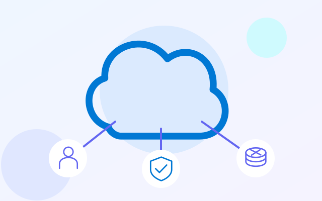
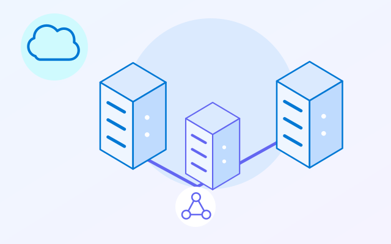
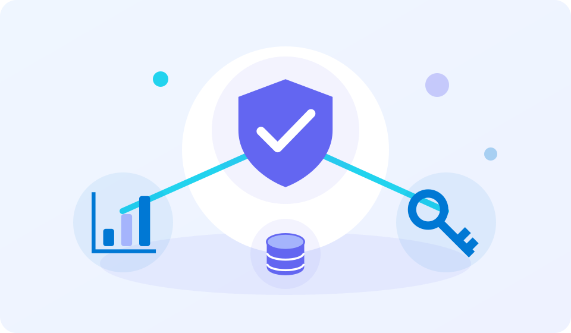
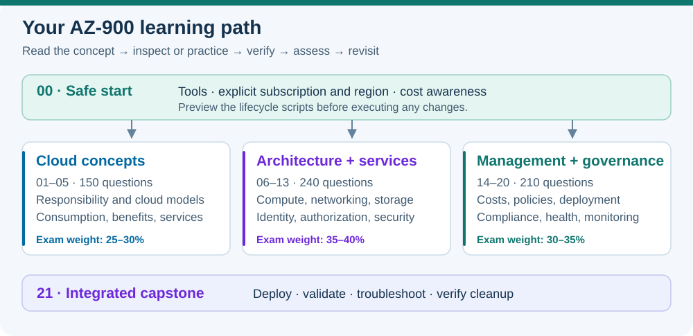

# AZ-900 Azure Fundamentals Labs

[](https://jamonygr.github.io/az900-azure-fundamentals-labs/)

**Build your Azure foundations, one lab at a time.** An illustrated, beginner-friendly path through cloud concepts, Azure services, and governance—with practical PowerShell-hosted Azure CLI exercises.

**22 labs · 600 original questions · 22 teaching visuals · 57 mapped objectives**

### [Start learning →](https://jamonygr.github.io/az900-azure-fundamentals-labs/) · [Practice questions →](https://jamonygr.github.io/az900-azure-fundamentals-labs/docs/quiz/) · [Browse the labs →](docs/catalog.md)

[](https://github.com/Jamonygr/az900-azure-fundamentals-labs/actions/workflows/quality-pages.yml)

## Explore your learning path

| Cloud concepts | Architecture and services | Management and governance |
| :---: | :---: | :---: |
| [](labs/01-cloud-responsibility/README.md) | [](labs/06-azure-architecture/README.md) | [](labs/14-cost-tags/README.md) |
| **Labs 01–05 · 150 questions** | **Labs 06–13 · 240 questions** | **Labs 14–20 · 210 questions** |
| Responsibility, cloud models, pricing, benefits, and service types | Resource hierarchy, compute, networking, storage, identity, and security | Costs, Policy, Purview, management tools, infrastructure as code, and monitoring |
| Exam weight: **25–30%** | Exam weight: **35–40%** | Exam weight: **30–35%** |

[](docs/assets/diagrams/learning-path.svg)

Every lab has its own teaching illustration. Open a visual at full size to explore its labels, then use the lesson's commands and explanations to test your understanding. Diagrams distinguish conceptual designs from the resources an exercise actually creates.

## Start here

1. Read [prerequisites](docs/prerequisites.md), [cost and cleanup guidance](docs/cost-cleanup.md), and the [permissions matrix](docs/permissions.md).
2. Complete [Lab 00](labs/00-safe-start/README.md) with PowerShell 7.4+, Azure CLI, and an approved disposable subscription.
3. Follow [your study pathway](docs/study-plan.md) through Labs 01–20, using each lesson's visual, scenario, guided exercise, and assessment.
4. Review missed objectives, then complete [Lab 21](labs/21-integrated-capstone/README.md): deploy, validate, explain, and clean up.

The hands-on curriculum requires an Azure subscription. Concept exercises use local reasoning; tenant-level and expensive services use inspection or clearly labeled examples.

## Learn, practise, and verify

Each lesson includes objectives, prerequisites, a scenario, explanations, guided exercises, expected observations, verification, troubleshooting, cleanup, and official references. The searchable site adds interactive assessments and browser-local progress. The [terminal runner](docs/assessments.md) also works offline.

The curriculum follows the [English AZ-900 objectives effective July 20, 2026](https://learn.microsoft.com/en-us/credentials/certifications/resources/study-guides/az-900). The [objective map](docs/objective-map.md) links every current objective to a lesson. Questions are original learning material, not Microsoft exam items or a guarantee of exam results.

## Safe execution

Supply your subscription, region, and unique run ID explicitly. Setup and cleanup preview by default. `-Execute` permits changes; storage and capstone setup also require `-AcknowledgeCost`. Read each preview before executing.

Azure resources can incur charges. Budget alerts do not stop spending. Cleanup is complete only after the owned resource group is absent. Personal configuration and evidence belong in the supplied ignored paths.

## Verification status

The repository is **offline-validated**: content coverage, schemas, links, script syntax, mocked lifecycle behavior, Bicep compilation, and documentation builds are checked. Azure exercises have **not** been live-tested by the repository author. Learners verify actual results in their own environments.

## Build locally

```powershell
python -m venv .venv
.venv/Scripts/python -m pip install -r requirements-dev.txt
.venv/Scripts/python tools/validate_repository.py
pwsh -NoProfile -File tests/Test-LabRuntime.ps1
.venv/Scripts/python tools/build_docs.py
.venv/Scripts/python -m mkdocs serve --strict
```

Use Python 3.11 or later. GitHub Actions checks quality before deploying the learning site from `main`.

## Contributing and credits

Read [contributing guidance](CONTRIBUTING.md), [security reporting](SECURITY.md), and [artwork notes](ASSET_NOTES.md). The repository uses the [MIT license](LICENSE). This independent curriculum is inspired by [our AZ-104 learning repository](https://github.com/Jamonygr/az104-azure-administrator-labs).
