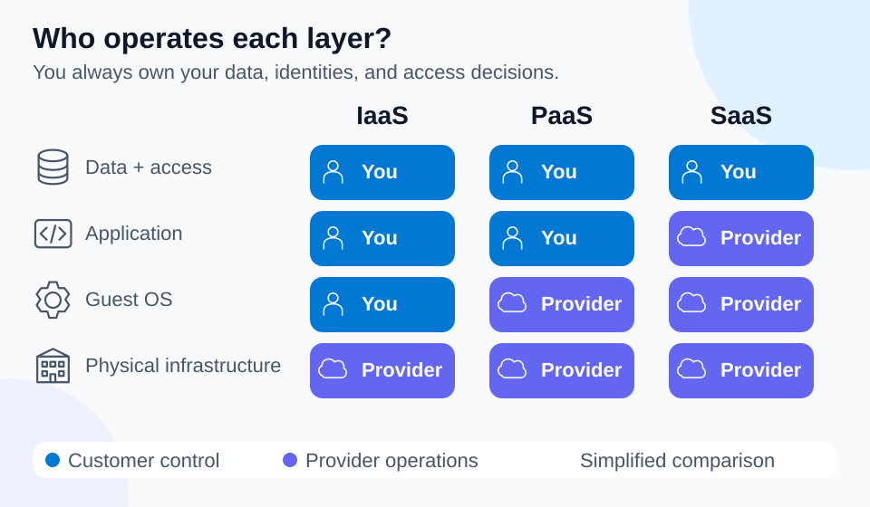

# Lab 01 — Cloud computing and shared responsibility

35 minutes · Concept exercise · Offline-validated

## Objectives

- **C01:** Explain cloud computing as access to computing services on demand.
- **C02:** Allocate provider and customer responsibilities for different service models.

## Prerequisites

Complete Lab 00. Use PowerShell 7.4+ and a local scratch directory. This exercise does not call Azure; later live exercises require your subscription.

## Scenario

A small library wants online reservations. Its team expects that moving to Azure means Microsoft will also decide which staff can read patron records. Test that assumption before choosing a hosting service.

## Concept primer

[](../../docs/assets/diagrams/shared-responsibility.svg)

*Simplified comparison: use the specific service documentation to resolve shared duties and configuration details.*

Cloud computing supplies services such as compute, storage, and networking through a provider. Resources can be provisioned when needed rather than bought as physical hardware first. A hosted application still needs deliberate access control, data handling, and availability design.

Microsoft maintains Azure's physical facilities, hardware, and underlying infrastructure. The customer remains responsible for their data, identities, and access decisions. In IaaS, the customer also manages the guest operating system and application. In PaaS, the provider manages more of the platform, while the customer manages their application and configuration. In SaaS, the customer uses a finished application but still controls accounts, information, and permitted use. Responsibility can be shared; inspect the particular service rather than assuming the label answers every detail.

## Guided exercise

1. Build a responsibility ledger locally:

```powershell
$ledger = @'
Task,IaaS,PaaS,SaaS
Maintain physical server,Provider,Provider,Provider
Patch guest operating system,Customer,Provider,Provider
Decide who can read patron data,Customer,Customer,Customer
Maintain custom application code,Customer,Customer,Provider
'@ | ConvertFrom-Csv
$ledger | Format-Table
$ledger | Where-Object SaaS -eq 'Customer' | Select-Object Task
```

2. Explain why the final command still prints two tasks even for SaaS. Then add a row for protecting a staff member's laptop: the organization remains responsible for the device it owns.
3. Break the ledger locally by changing the SaaS data-access entry to `Provider`. Name the harm this mistake could cause and restore `Customer`.
4. Verify your reasoning: who replaces a failed physical disk, who removes an departed employee's access, and who patches a VM's guest OS? Answers: provider, customer, customer.

## Expected results

You have a responsibility ledger and can justify each assignment. Cloud adoption changes the boundary of operational work; it does not remove the need to protect data or identities. Explain an on-demand benefit without claiming every cloud service automatically scales.

## Knowledge check

Complete the 30 original questions in [questions.json](questions.json), or use the site's assessment. Review explanations for every incorrect choice. Before advancing, explain C01 and C02 in your own words without looking at the ledger.

## Troubleshooting

If the table displays as plain text, pipe the here-string into `ConvertFrom-Csv`. If you assigned every task to Microsoft, separate physical infrastructure from application configuration and business permissions. A successfully authenticated user can still have excessive access.

## Cleanup

No Azure resources were created. Clear the local variable with `Remove-Variable ledger`; remove any personal notes from your scratch directory if no longer needed.

## References

- [Cloud computing fundamentals](https://learn.microsoft.com/en-us/training/modules/describe-cloud-compute/)
- [Shared responsibility in the cloud](https://learn.microsoft.com/en-us/azure/security/fundamentals/shared-responsibility)
- [AZ-900 study guide](https://learn.microsoft.com/en-us/credentials/certifications/resources/study-guides/az-900)
