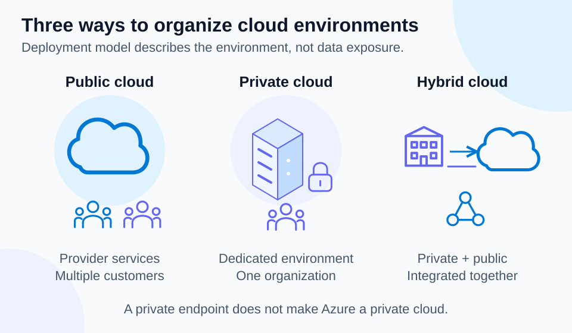

# Lab 02 — Public, private, and hybrid cloud models

35 minutes · Concept exercise · Offline-validated

## Objectives

- **C03:** Distinguish public, private, and hybrid cloud.
- **C04:** Choose a cloud model using actual workload constraints.

## Prerequisites

Complete Lab 01. Use PowerShell 7.4+. You will make local decisions rather than provision infrastructure.

## Scenario

A manufacturer has a factory system that must remain on its own network, a new public product catalog, and orders that flow between them. Choose deployment models separately for the workloads rather than forcing one answer for the company.

## Concept primer

[](../../docs/assets/diagrams/cloud-models.svg)

*Deployment model describes the environment. Public cloud does not mean public data, and private networking does not change the cloud model.* [Open visual at full size](../../docs/assets/diagrams/cloud-models.svg).

A public cloud offers provider-owned services to multiple customers, with logical separation and controlled access. Public cloud does not mean public access to your data. A private cloud is dedicated to one organization; it can be operated internally or by a third party. Owning an ordinary server alone does not supply the automation and on-demand capabilities of a private cloud.

Hybrid cloud combines public and private environments with integration. A network connection can support that integration, but workload, identity, data, and management decisions also matter. Multicloud means using more than one cloud provider and is not the same definition as hybrid. Choose a model based on control, residency, existing investments, integration needs, staffing, and costs; a regulated workload is not automatically prohibited from public cloud.

## Guided exercise

1. Create a decision log:

```powershell
$decisions = @'
Workload,Constraint,Model
Factory control,Keep required local dependency,Private
Product catalog,Launch rapidly with provider capacity,Public
Order integration,Connect retained private system with Azure,Hybrid
'@ | ConvertFrom-Csv
$decisions | Format-Table -Wrap
$decisions | Group-Object Model | Select-Object Name,Count
```

2. Give each choice one benefit and one remaining responsibility. The catalog can use provider capacity, but its customer still controls access and spending.
3. Change the factory constraint to `Vendor supports cloud deployment; no local dependency`. Decide whether private remains justified. Record what information you would need before moving it: latency, data requirements, support, and migration cost.
4. Diagnose the claim `Our Azure database is private cloud because its network endpoint is private`. A private endpoint changes access to a public-cloud service; it does not change Azure's deployment model.
5. Verify: if both sides of the order integration are moved into Azure, would that specific workload still demonstrate the original hybrid scenario? No: the retained private component was the defining constraint.

## Expected results

Three decisions have reasons tied to constraints. You can distinguish ownership/deployment models from network exposure and service models. You also know which missing facts could change a recommendation.

## Knowledge check

Complete [the 30 questions](questions.json). Explain a case where public cloud is appropriate despite confidential data, then name the access and governance controls still needed.

## Troubleshooting

Do not classify a workload by its user count or its internet-facing website alone. `Public` describes the provider offering, while a public endpoint describes connectivity. If two choices seem reasonable, identify the decisive requirement rather than inventing a universal ranking.

## Cleanup

No Azure resources were created. Run `Remove-Variable decisions` and delete optional local notes when finished.

## References

- [Cloud models and use cases](https://learn.microsoft.com/en-us/training/modules/describe-cloud-compute/)
- [Cloud adoption strategy](https://learn.microsoft.com/en-us/azure/cloud-adoption-framework/strategy/)
- [Private endpoint overview](https://learn.microsoft.com/en-us/azure/private-link/private-endpoint-overview)
