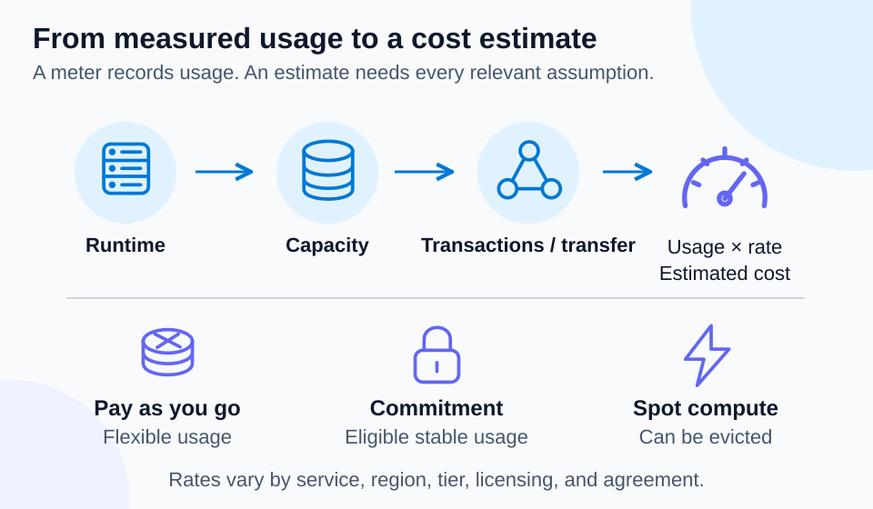

# Lab 03 — Consumption and cloud pricing

40 minutes · Concept exercise · Offline-validated

## Objectives

- **C05:** Explain billing based on measured consumption.
- **C06:** Compare flexible pricing and commitment-based discounts.

## Prerequisites

Complete Lab 02. Use PowerShell 7.4+. The numbers below are fictional teaching values, not Azure quotes. No Azure resources are deployed.

## Scenario

A ticketing business runs a small site most days but needs extra capacity during a festival. Finance asks whether a predictable bill is the same thing as the lowest possible bill.

## Concept primer

[](../../docs/assets/diagrams/cloud-pricing.svg)

*An estimate needs rates and usage assumptions for all relevant meters. This illustration contains no live price quote.* [Open visual at full size](../../docs/assets/diagrams/cloud-pricing.svg).

Consumption-based pricing measures service usage, such as runtime, capacity, transactions, or data transfer. Buying servers upfront is capital expenditure; paying for ongoing services is usually operating expenditure. A subscription is not a promise that every service is free or charged by the same meter.

Pay-as-you-go favors flexibility. Reservations and savings plans can reduce eligible compute costs in exchange for commitments; their scope, terms, and coverage differ. Spot compute uses spare capacity at variable discounts and can be evicted, making it unsuitable for an uninterrupted service without an interruption-tolerant design. Pricing depends on service, region, tier, licensing, usage, and agreement. Estimates require assumptions and are not invoices. A budget alert informs you; it does not automatically stop every resource.

## Guided exercise

1. Calculate a fictional month locally:

```powershell
$usage = @'
Meter,Units,UnitPrice
ComputeHours,120,0.20
StorageGBMonth,10,0.03
WriteOperations,1000,0.00001
'@ | ConvertFrom-Csv
$lines = $usage | ForEach-Object {
    [pscustomobject]@{Meter=$_.Meter; Cost=[decimal]$_.Units * [decimal]$_.UnitPrice}
}
$lines | Format-Table
($lines | Measure-Object Cost -Sum).Sum
```

2. Verify the result is `24.31`. Increase compute hours to `240`; the compute component doubles, while the unchanged components do not.
3. Compare the festival worker with a stable year-round database. Explain why a commitment may suit stable eligible usage, while temporary demand may suit pay-as-you-go.
4. Break the estimate by omitting storage. The script still succeeds, but the estimate is incomplete. Restore the missing meter and record network transfer, licensing, and support as assumptions to investigate.
5. Use the [pricing calculator](https://azure.microsoft.com/en-us/pricing/calculator/) to inspect a current service estimate without deploying it. Record date, region, SKU, currency, and assumed usage locally; do not treat the fictional example as a real price.

## Expected results

You can recalculate costs, explain each meter, and distinguish discounts from freedom to terminate a commitment. Your estimate includes assumptions and a reminder to compare actual usage after deployment.

## Knowledge check

Complete [the 30 questions](questions.json). Explain why a VM shut down inside its guest OS can still incur compute allocation charges, and why a deallocated VM can retain separately billed disks.

## Troubleshooting

CSV values are strings: cast to `[decimal]` before multiplying. A low estimate may reflect missing meters rather than efficient architecture. If prices differ across regions, compare equivalent SKUs and licensing assumptions.

## Cleanup

No Azure resources were created. Run `Remove-Variable usage,lines`. Close the calculator or keep your local estimate as study evidence.

## References

- [Consumption-based cloud concepts](https://learn.microsoft.com/en-us/training/modules/describe-cloud-compute/)
- [Azure Reservations](https://learn.microsoft.com/en-us/azure/cost-management-billing/reservations/save-compute-costs-reservations)
- [Azure savings plan for compute](https://learn.microsoft.com/en-us/azure/cost-management-billing/savings-plan/savings-plan-compute-overview)
- [Spot virtual machines](https://learn.microsoft.com/en-us/azure/virtual-machines/spot-vms)
- [Virtual machine states and billing](https://learn.microsoft.com/en-us/azure/virtual-machines/states-billing)
