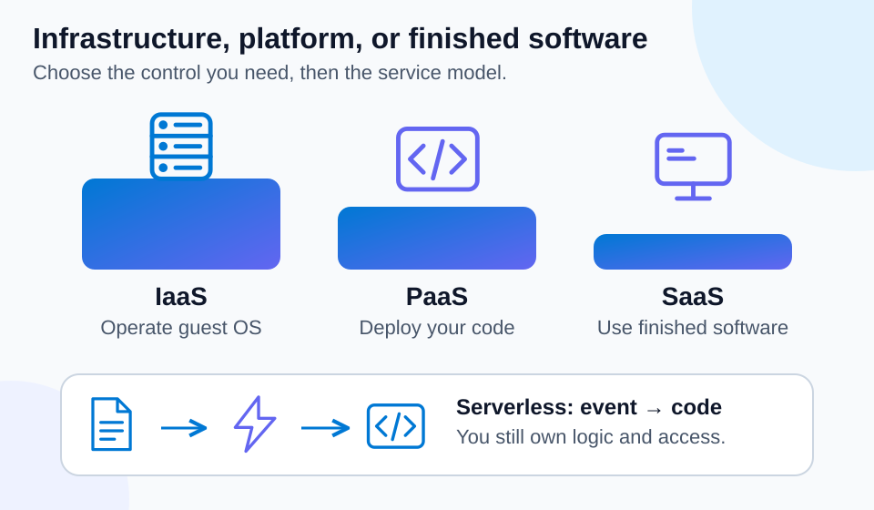

# Lab 05 — Service models and serverless decisions

45 minutes · Concept exercise · Offline-validated

## Objectives

- **C07:** Explain event-driven serverless computing.
- **C12–C14:** Compare IaaS, PaaS, and SaaS responsibilities.
- **C15:** Choose a service model for a workload.

## Prerequisites

Complete Labs 01–04. Use PowerShell 7.4+. This decision exercise deploys no services.

## Scenario

A charity needs email, a custom donation website, an old application requiring a specific operating system, and an image-processing task triggered by new uploads. Choose the smallest operational burden that satisfies each requirement.

## Concept primer

[](../../docs/assets/diagrams/service-models.svg)

*Choose the control the workload needs. Serverless still requires customer-managed logic, access, and telemetry.* [Open visual at full size](../../docs/assets/diagrams/service-models.svg).

IaaS provides infrastructure building blocks such as virtual machines; you manage the guest OS and applications. PaaS provides a managed application platform; you deploy application code and choose supported settings without operating its underlying OS. SaaS is a finished application used through its provided interface and configuration.

Serverless abstracts server provisioning and management from the developer and commonly runs code in response to events. Servers still exist, and application logic, dependencies, authorization, and telemetry remain your responsibility. Azure Functions supports multiple hosting plans; scaling, billing, and cold-start behavior depend on the plan. Do not assume that every Functions plan bills only per execution. Containers package application code and dependencies; the hosting service determines how much infrastructure you operate.

## Guided exercise

1. Make a workload ledger:

```powershell
$models = @'
Requirement,Choice,Reason
Standard email,SaaS,Use a finished application
Custom website without OS management,PaaS,Deploy code to a managed platform
Legacy software with OS-level customization,IaaS,Retain guest OS control
React to each uploaded image,Serverless function,Use an event trigger
'@ | ConvertFrom-Csv
$models | Format-Table -Wrap
$models | Where-Object Choice -eq 'IaaS'
```

2. For each row, name a customer responsibility. Expected examples: email accounts/data, website code, OS patching, and function authorization/error handling.
3. Break the website choice by adding `Requires an unsupported OS kernel driver`. Reassess it: a managed web platform may not support that requirement; a VM provides OS control at the cost of more maintenance.
4. Contrast a function with an always-running VM for a short upload event. Describe event handling, retry/idempotency, monitoring, and plan selection before discussing savings.
5. Verify your reasoning with a counterexample: a container on a self-managed VM does not transfer guest OS patching to Microsoft just because the application is packaged.

## Expected results

Four recommendations connect requirements to operational responsibilities. You can explain why service model, deployment model, and application packaging are separate decisions. You can also describe serverless without claiming there are no servers or no operational work.

## Knowledge check

Complete [the 30 questions](questions.json). Revisit Lab 01 if you transfer data or identity responsibilities to the provider when selecting SaaS.

## Troubleshooting

If two options fit, identify the requirement that decides: OS control, supported runtime, completed business functionality, or event processing. A managed platform does not automatically repair errors in your code. Serverless pricing depends on hosting and usage.

## Cleanup

No Azure resources were created. Run `Remove-Variable models` and keep only useful local decision notes.

## References

- [Cloud service types](https://learn.microsoft.com/en-us/training/modules/describe-cloud-service-types/)
- [Shared responsibility](https://learn.microsoft.com/en-us/azure/security/fundamentals/shared-responsibility)
- [Azure Functions overview](https://learn.microsoft.com/en-us/azure/azure-functions/functions-overview)
- [Azure Functions hosting options](https://learn.microsoft.com/en-us/azure/azure-functions/functions-scale)
