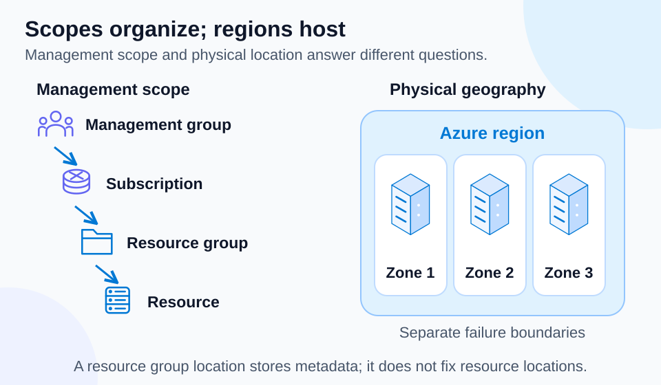

# Lab 06 — Azure architecture and resource hierarchy

45 minutes · Live: one resource group · Offline-validated; Azure execution is learner-run

## Objectives

- **A01–A03:** Explain regions, region pairs, sovereign clouds, zones, and datacenters.
- **A04–A07:** Navigate resources, resource groups, subscriptions, and management groups.

## Prerequisites

Complete Lab 00, authenticate with Azure CLI, and have permission to create/delete a resource group in your explicit subscription. Use PowerShell 7.4+ and choose an approved Azure region. Run commands from this lab directory. Store personal configuration/evidence only in ignored local locations.

## Scenario

A training team needs a boundary for its disposable resources. First create an empty resource group, then distinguish its metadata location from the locations of resources it may later contain.

## Concept primer

[](../../docs/assets/diagrams/azure-hierarchy.svg)

*Management scope and physical geography are separate. This exercise creates only an empty resource group.* [Open visual at full size](../../docs/assets/diagrams/azure-hierarchy.svg).

A datacenter is a physical facility; a region groups datacenters and networking within a geographic area. Availability zones are separated groups of datacenters inside a region, with independent power, cooling, and networking. Zone support depends on region and service. Some regions are paired and others are nonpaired; pairing does not automatically replicate every resource. Sovereign clouds have separate operational and eligibility boundaries, such as Azure Government or Azure operated by 21Vianet.

Management groups organize subscriptions for inherited governance. Subscriptions contain resource groups and establish billing/access boundaries. A resource group organizes resources with a related lifecycle; each resource belongs to one resource group at a time. A group's location stores its metadata; resources inside can be in different regions. Deleting a group deletes its contained resources, subject to locks and permissions.

## Guided exercise

1. Set values deliberately; use your own subscription GUID and approved region:

```powershell
$SubscriptionId = 'YOUR-SUBSCRIPTION-GUID'
$Location = 'YOUR-APPROVED-REGION'
$RunId = 'study01'
$ResourceGroup = "rg-az900-06-$RunId"
az account show --subscription $SubscriptionId --query '{id:id,name:name,tenantId:tenantId}' -o json
az account list-locations --subscription $SubscriptionId --query '[].{Name:name,DisplayName:displayName}' -o table
./Preflight.ps1 -SubscriptionId $SubscriptionId -Location $Location -RunId $RunId
./Setup.ps1 -SubscriptionId $SubscriptionId -Location $Location -RunId $RunId
```

2. Inspect the preview. It must target this lab and run. Then execute and inspect:

```powershell
./Setup.ps1 -SubscriptionId $SubscriptionId -Location $Location -RunId $RunId -Execute
az group show --name $ResourceGroup --subscription $SubscriptionId --query '{id:id,location:location,tags:tags}' -o json
az resource list --resource-group $ResourceGroup --subscription $SubscriptionId -o table
./Validate.ps1 -SubscriptionId $SubscriptionId -Location $Location -RunId $RunId
```

3. Read the resource-group ID: identify `/subscriptions/.../resourceGroups/...`. The resource list should be empty; the group is a container, not a VM.
4. Check `az900-project`, `az900-lab=06`, and `az900-run` ownership tags. Explain why a group name alone cannot prove ownership.
5. Break-fix without changing Azure: preview setup with an invalid run ID containing spaces. Expect validation refusal; restore the original ID. Do not retag unrelated groups to bypass ownership safeguards.

## Expected results

One tagged empty resource group exists in the selected subscription. Its metadata region is visible. You can draw the hierarchy and describe which physical failure a zone or a second region can address. No compute has been deployed.

## Knowledge check

Complete [the 30 questions](questions.json). Explain why a resource group's region does not prove all future resources are in that region, and why a paired region is not a backup of your application.

## Troubleshooting

`AuthorizationFailed` means your identity lacks required permissions at the target scope; ask the subscription administrator for approved access. `LocationNotAvailableForResourceType` or policy denial requires an allowed region, not removal of organizational controls. `ResourceGroupNotFound` after preview is expected because preview makes no changes.

## Cleanup

```powershell
./Cleanup.ps1 -SubscriptionId $SubscriptionId -Location $Location -RunId $RunId
./Cleanup.ps1 -SubscriptionId $SubscriptionId -Location $Location -RunId $RunId -Execute
az group exists --name $ResourceGroup --subscription $SubscriptionId -o tsv
```

The final command must return `false`. Cleanup verifies ownership and removal; resolve an authorized lock or permission failure before marking the lab complete.

## References

- [Core Azure architecture](https://learn.microsoft.com/en-us/training/modules/describe-core-architectural-components-of-azure/)
- [Regions](https://learn.microsoft.com/en-us/azure/reliability/regions-overview)
- [Availability zones](https://learn.microsoft.com/en-us/azure/reliability/availability-zones-overview)
- [Resource groups](https://learn.microsoft.com/en-us/azure/azure-resource-manager/management/manage-resource-groups-cli)
- [Management groups](https://learn.microsoft.com/en-us/azure/governance/management-groups/overview)
