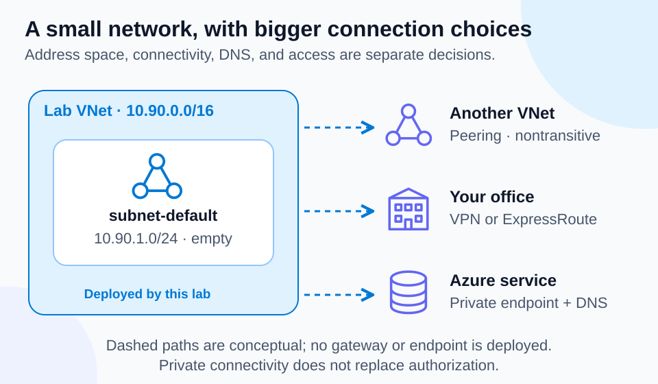

# Lab 08 — Virtual networks and connectivity

50 minutes · Live: virtual network and subnet · Offline-validated; Azure execution is learner-run

## Objectives

- **A12:** Explain VNets, subnets, peering, DNS, VPN Gateway, and ExpressRoute.
- **A13:** Distinguish public and private endpoints.

## Prerequisites

Complete Lab 06. Use PowerShell 7.4+, authenticated Azure CLI, and approved resource-group/network permissions. Choose a permitted region. Run from this lab directory. This lab deploys no VMs, gateways, public IPs, private endpoints, or peering.

## Scenario

A team wants space for private application addresses. Inspect a small VNet and explain which additional services would be needed for on-premises connectivity or private access to a storage service.

## Concept primer

[](../../docs/assets/diagrams/virtual-networking.svg)

*Only the VNet and subnet in the upper-left panel are deployed. The connectivity choices are conceptual examples.*

A VNet is an isolated logical network with IP address space; subnets partition that space. Routing and security controls determine allowed traffic. An empty subnet hosts no application. Peering connects VNets through the Azure backbone; peering is not automatically transitive. DNS resolves names to addresses and does not authorize access. Azure DNS hosts a domain's DNS records; Azure Private DNS supports name resolution through private zones for connected virtual networks.

VPN Gateway provides encrypted VPN connectivity across public networks. ExpressRoute provides private connectivity through a connectivity provider; private connectivity is not a universal claim of encryption. A public endpoint uses a publicly routable address but can still require authentication and restrict access. A private endpoint gives a service a private IP in your VNet through Private Link; DNS and network reachability must be designed for clients. Creating a private endpoint does not inherently disable the service's public endpoint.

## Guided exercise

```powershell
$SubscriptionId = 'YOUR-SUBSCRIPTION-GUID'
$Location = 'YOUR-APPROVED-REGION'
$RunId = 'study01'
$ResourceGroup = "rg-az900-08-$RunId"
./Preflight.ps1 -SubscriptionId $SubscriptionId -Location $Location -RunId $RunId
./Setup.ps1 -SubscriptionId $SubscriptionId -Location $Location -RunId $RunId
./Setup.ps1 -SubscriptionId $SubscriptionId -Location $Location -RunId $RunId -Execute
az network vnet show --resource-group $ResourceGroup --name vnet-az900 --subscription $SubscriptionId --query '{addressSpace:addressSpace.addressPrefixes,subnets:subnets[].{name:name,prefix:addressPrefix}}' -o json
az network vnet subnet show --resource-group $ResourceGroup --vnet-name vnet-az900 --name subnet-default --subscription $SubscriptionId --query '{id:id,prefix:addressPrefix}' -o json
./Validate.ps1 -SubscriptionId $SubscriptionId -Location $Location -RunId $RunId
```

1. Before `-Execute`, verify the preview's names and ownership tags. Identify which address prefix contains the subnet and why subnet ranges must not overlap.
2. Read the subnet ID: it is a child of the VNet resource. Explain why this empty network does not make an Azure Storage account private.
3. Make a local connectivity map: another VNet → peering; office over internet → VPN; provider private circuit → ExpressRoute; private service IP → private endpoint plus DNS.
4. Break-fix on paper: VNet A peers with B, and B with C; the designer expects A-to-C traffic automatically. Correct the assumption: peering is nontransitive; design explicit connectivity/routing.
5. Verify the deployed network with `Validate.ps1`. Do not test internet exposure by creating a VM or gateway.

## Expected results

One owned VNet with `10.90.0.0/16` and subnet `subnet-default` with `10.90.1.0/24` exist in the lab's group. You can explain the containment relationship, connectivity options, and why private addresses do not replace authentication or traffic filtering.

## Knowledge check

Complete [the 30 questions](questions.json). Explain the independent roles of DNS, connectivity, and authorization in a private-endpoint design.

## Troubleshooting

For provider registration or policy errors, ask the subscription administrator for the approved path; do not disable policy. An overlapping-address design problem is solved by planning nonoverlapping prefixes. A private endpoint resolving to a public IP usually calls for checking DNS configuration, not weakening authentication.

## Cleanup

```powershell
./Cleanup.ps1 -SubscriptionId $SubscriptionId -Location $Location -RunId $RunId
./Cleanup.ps1 -SubscriptionId $SubscriptionId -Location $Location -RunId $RunId -Execute
az group exists --name $ResourceGroup --subscription $SubscriptionId -o tsv
```

Confirm `false`. Cleanup removes only the verified owned lab group.

## References

- [Azure DNS](https://learn.microsoft.com/en-us/azure/dns/dns-overview)

- [Virtual Network overview](https://learn.microsoft.com/en-us/azure/virtual-network/virtual-networks-overview)
- [Virtual network peering](https://learn.microsoft.com/en-us/azure/virtual-network/virtual-network-peering-overview)
- [VPN Gateway](https://learn.microsoft.com/en-us/azure/vpn-gateway/vpn-gateway-about-vpngateways)
- [ExpressRoute](https://learn.microsoft.com/en-us/azure/expressroute/expressroute-introduction)
- [Private endpoints](https://learn.microsoft.com/en-us/azure/private-link/private-endpoint-overview)
