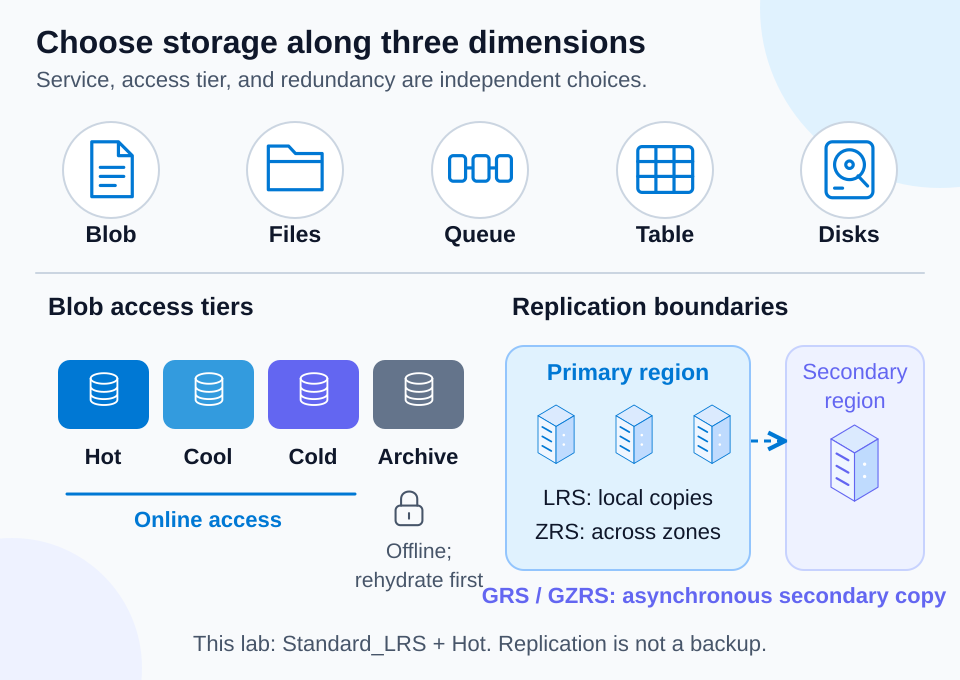

# Lab 09 — Storage services, tiers, and redundancy

50 minutes · Live: small storage account · Offline-validated; Azure execution is learner-run

## Objectives

- **A14:** Select Blob, Files, Queue, Table, or Disk storage.
- **A15–A17:** Explain access tiers, redundancy, and account types.

## Prerequisites

Complete Lab 06. Use PowerShell 7.4+ and Azure CLI with resource-group/storage management permissions. Choose an approved region and a short lowercase alphanumeric run ID. Storage names are globally unique. Run from this lab directory. Storage operations/capacity may incur charges; acknowledge costs only after inspecting the preview.

## Scenario

A museum stores images, shares office documents, and queues thumbnail work. Create one general-purpose account and inspect its settings; choose services for the other requirements without deploying them.

## Concept primer

[](../../docs/assets/diagrams/storage-decisions.svg)

*The live exercise uses Standard_LRS and Hot. Other tiers and replication arrangements are conceptual; redundancy is not a backup.* [Open visual at full size](../../docs/assets/diagrams/storage-decisions.svg).

Blob stores objects such as images; Files supplies managed file shares; Queue carries asynchronous messages; Table stores structured NoSQL entities; managed disks supply VM block storage. A standard general-purpose v2 account (`StorageV2`) supports several storage services. Premium account types target specific performance/workload requirements; do not assume every type supports every service or tier.

Hot, cool, and cold blob tiers provide online access with different capacity/access economics; archive is offline and requires rehydration before reading. Minimum-retention and retrieval charges depend on tier. Tiers apply to supported blob/account configurations, not every Azure storage service.

LRS replicates locally in the primary region; ZRS replicates across zones in the primary region. GRS adds asynchronous replication to a secondary region; GZRS combines zonal primary replication with geographic replication. RA variants allow reading the secondary endpoint. Asynchronous replication can lose recent writes in a disaster. Redundancy is not a substitute for recovering accidentally deleted or corrupted data.

## Guided exercise

```powershell
$SubscriptionId = 'YOUR-SUBSCRIPTION-GUID'
$Location = 'YOUR-APPROVED-REGION'
$RunId = 'study01'
$ResourceGroup = "rg-az900-09-$RunId"
$StorageAccount = "staz90009$RunId"
./Preflight.ps1 -SubscriptionId $SubscriptionId -Location $Location -RunId $RunId
./Setup.ps1 -SubscriptionId $SubscriptionId -Location $Location -RunId $RunId
./Setup.ps1 -SubscriptionId $SubscriptionId -Location $Location -RunId $RunId -Execute -AcknowledgeCost
az storage account show --resource-group $ResourceGroup --name $StorageAccount --subscription $SubscriptionId --query '{kind:kind,sku:sku.name,accessTier:accessTier,httpsOnly:enableHttpsTrafficOnly,minimumTlsVersion:minimumTlsVersion,allowBlobPublicAccess:allowBlobPublicAccess,blobEndpoint:primaryEndpoints.blob}' -o json
az storage container-rm show --storage-account $StorageAccount --resource-group $ResourceGroup --name practice --subscription $SubscriptionId --query '{name:name,publicAccess:publicAccess,metadata:metadata}' -o json
./Validate.ps1 -SubscriptionId $SubscriptionId -Location $Location -RunId $RunId
```

1. Inspect preview names/tags before execution. Expect `StorageV2`, `Standard_LRS`, `Hot`, HTTPS-only, `TLS1_2`, and disabled public blob access. Setup also creates the private `practice` container; inspect its ownership metadata. No account key is needed.
2. Explain what `Standard_LRS` protects against and what a regional disaster would still threaten. Compare a hypothetical ZRS account without changing this account.
3. Assign images → Blob, shared documents → Files, thumbnail work → Queue, and VM OS disk → managed disk. Explain each choice.
4. Break-fix on paper: placing a frequently read thumbnail in archive blocks immediate online retrieval. Choose an online tier and compare total access/capacity cost before deciding.
5. Verify that a public DNS endpoint does not mean anonymous blob reads are permitted. Lab 10 will exercise authenticated blob data access separately from management permissions.

## Expected results

One owned storage account exists and its settings match the lifecycle validator. You can separate account type, service, access tier, and redundancy. Your recommendations account for access frequency and recovery needs.

## Knowledge check

Complete [the 30 questions](questions.json). Explain why RA-GRS enables secondary reads but does not make its secondary a normal independent write target.

## Troubleshooting

`StorageAccountAlreadyTaken` requires a new safe run ID and corresponding new lab group; do not adopt an account you do not own. Policy or region/SKU restrictions require approved alternatives. `AuthorizationPermissionMismatch` on blob data is different from being unable to manage account properties.

## Cleanup

```powershell
./Cleanup.ps1 -SubscriptionId $SubscriptionId -Location $Location -RunId $RunId
./Cleanup.ps1 -SubscriptionId $SubscriptionId -Location $Location -RunId $RunId -Execute
az group exists --name $ResourceGroup --subscription $SubscriptionId -o tsv
```

Confirm `false`; retain no storage keys or personal data in study evidence.

## References

- [Storage services](https://learn.microsoft.com/en-us/azure/storage/common/storage-introduction)
- [Storage account types](https://learn.microsoft.com/en-us/azure/storage/common/storage-account-overview)
- [Blob access tiers](https://learn.microsoft.com/en-us/azure/storage/blobs/access-tiers-overview)
- [Storage redundancy](https://learn.microsoft.com/en-us/azure/storage/common/storage-redundancy)
