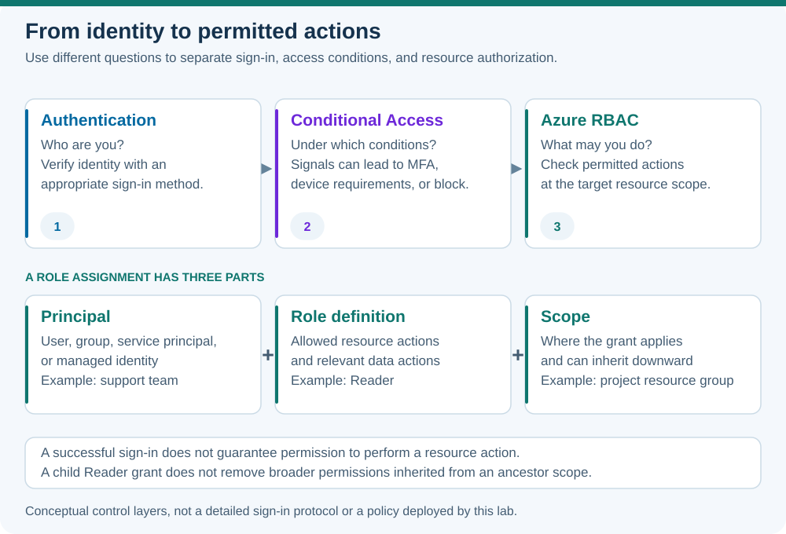

# Lab 12 — Authentication, Conditional Access, and RBAC

**45 minutes · Read-only inspection · Offline-validated**

## Objectives

- **A21:** Explain SSO, MFA, and passwordless authentication.
- **A23:** Explain how Conditional Access uses signals and access requirements.
- **A24:** Identify a role assignment's principal, role definition, and scope.

## Prerequisites

Complete [Lab 00](../00-safe-start/README.md) and [Lab 11](../11-identity-directory/README.md). Use PowerShell 7.4+, Azure CLI, and a subscription you may inspect. This exercise reads role definitions; it neither creates assignments nor changes tenant sign-in policy.

## Scenario

A support technician must inspect resources for one project. A deployer must modify the project's resources. A remote employee needs to access an app from a device that does not meet the organization's requirements. Decide which question belongs to authentication, Conditional Access, or Azure resource authorization.

## Concept primer

[](../../docs/assets/diagrams/identity-access.svg)

*Conceptual control layers: successful sign-in alone does not grant resource permission.*

**Authentication** verifies identity. **Authorization** determines permitted actions. SSO reuses an established sign-in across integrated applications; each app still applies its permissions. MFA combines different categories of evidence: knowledge, possession, and biometrics. Two memorized passwords are not two different factor categories. Passwordless methods such as passkeys can use a device-held credential unlocked with a PIN or biometric; security properties vary between methods.

Conditional Access connects signals—such as user, application, location, risk, and device state—to grant or block controls. A rule might require MFA or a compliant device. Its evaluation generally follows first-factor authentication. A valid password therefore does not guarantee access. Real policy changes require suitable authority, licensing, testing, and a plan to avoid administrator lockout; this lab uses invented cases.

Azure RBAC governs Azure resource actions. A role assignment combines **principal + role definition + scope**. Scope descends from management group to subscription, resource group, and resource. Applicable grants generally add together: assigning Reader on a child group does not cancel inherited Contributor. Reader views resources; Contributor manages them but cannot grant Azure RBAC access; Owner also manages access. Management permissions and data permissions can differ, especially for storage.

## Guided exercise

1. Inspect the account and the three general role definitions. Commands explicitly target the supplied subscription.

   ```powershell
   $SubscriptionId = Read-Host 'Enter your lab subscription GUID'
   az account show --subscription $SubscriptionId --query '{id:id,state:state}' --output json
   if ($LASTEXITCODE -ne 0) { throw 'Account inspection failed' }
   foreach ($role in 'Reader','Contributor','Owner') {
     az role definition list --name $role --subscription $SubscriptionId --query '[].{role:roleName,permissions:permissions}' --output json
     if ($LASTEXITCODE -ne 0) { throw "Role definition inspection failed: $role" }
   }
   ```

   Compare `actions`, `notActions`, and `dataActions`. These are definitions of possible permissions, not proof of your own assignments. Do not query or publish other users' access lists.

2. Write a local permission plan: technician → Reader at the project resource group; deployer → Contributor there. Explain why subscription Owner exceeds each task. Leave the plan on paper; do not execute a role-assignment command.

3. Classify these synthetic events:

   | Event | Decision layer |
   |---|---|
   | A registered passkey proves the user's identity | Authentication |
   | An unmanaged device fails an app's compliant-device requirement | Conditional Access |
   | A Reader tries to update a VNet | Azure RBAC authorization |
   | A user signs in once and opens another integrated app | SSO experience |

4. Break-fix reasoning: give a fictional user Contributor on a subscription and Reader on its lab group. Predict effective access, then correct the design by removing the unnecessarily broad grant in your written plan. No real roles are changed.

5. Verify: can a storage-account manager necessarily read blobs using Entra authentication? Explain why the required data role must be checked separately.

## Expected results

You can read definitions without changing access. You can select a small scope, distinguish sign-in from permitted actions, and explain why a child Reader grant is not a restriction on a parent Contributor grant. The synthetic device denial belongs to Conditional Access, not a resource lock.

## Knowledge check

Complete the [30 original questions](questions.json). Aim for 24/30 and explain missed answers. For every authorization scenario, identify the principal, action, and scope before naming a role.

## Troubleshooting

- **Role query denied:** verify subscription visibility and use the official built-in-role documentation for the conceptual comparison. Do not grant yourself permissions.
- **CLI output is confusing:** request JSON and inspect `permissions`; Azure CLI inside PowerShell is different from the Azure PowerShell Az module.
- **“MFA makes me Owner”:** stronger authentication supplies evidence of identity, not a resource-role grant.
- **“SSO bypasses policy”:** an established sign-in can still face access conditions and app authorization.

## Cleanup

No users, policies, or assignments are created. Clear `$SubscriptionId` and keep only synthetic role plans. Do not disable MFA, alter Conditional Access, or assign roles for this exercise.

## References

- [Microsoft Entra MFA](https://learn.microsoft.com/en-us/entra/identity/authentication/concept-mfa-howitworks)
- [Passkeys in Microsoft Entra ID](https://learn.microsoft.com/en-us/entra/identity/authentication/concept-authentication-passkeys-fido2)
- [Conditional Access overview](https://learn.microsoft.com/en-us/entra/identity/conditional-access/overview)
- [Azure RBAC overview](https://learn.microsoft.com/en-us/azure/role-based-access-control/overview)
- [Azure built-in roles](https://learn.microsoft.com/en-us/azure/role-based-access-control/built-in-roles)
