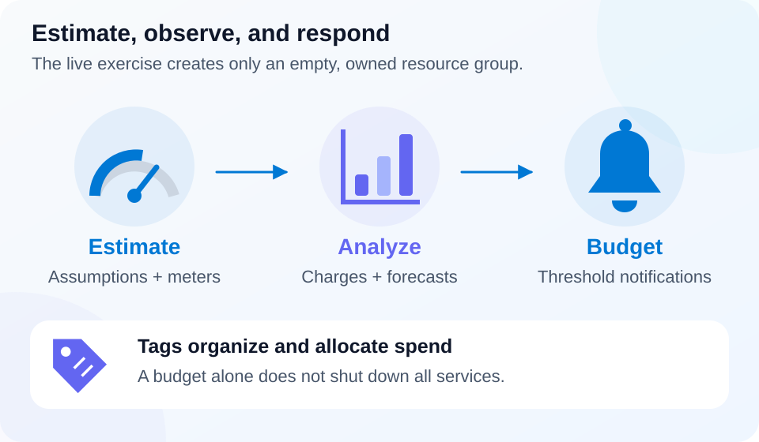

# Lab 14 — Cost management and resource tags

**45 minutes · Owned resource group · Offline-validated**

## Objectives

- **M01:** Identify workload cost drivers.
- **M02:** Explain how to build and compare pricing-calculator estimates.
- **M03:** Distinguish cost analysis, forecasts, and budgets.
- **M04:** Use tags as organizational metadata and recognize their limits.

## Prerequisites

Complete [Lab 00](../00-safe-start/README.md). From the repository root, use PowerShell 7.4+, Azure CLI, an enabled lab subscription, and permission to create and delete a resource group. Supply your own subscription GUID and canonical Azure region. This lab creates an empty tagged group, not a VM, storage account, budget, or billing export.

## Scenario

A project team needs to estimate a future workload and identify which resources belong to its study run. You will create one empty group, inspect its ownership tags, and practice a cost estimate using stated assumptions. There are no fixed price claims in this lesson: consult current service pricing before deploying chargeable services.

## Concept primer

[](../../docs/assets/diagrams/cost-controls.svg)

*Budgets notify at thresholds; this lab creates only an empty owned group.* [Open full-size visual](../../docs/assets/diagrams/cost-controls.svg).

Cost depends on the service's meters and configuration: SKU, region, duration, stored capacity, transactions, data transfer, and optional monitoring can matter. A deallocated VM can leave billable disks and other resources. Resource groups and ordinary tags do not themselves deploy compute, but putting resources in a group can introduce charges.

The pricing calculator estimates a proposed workload from assumptions. It does not deploy resources, guarantee an invoice, or enforce a spending cap. Compare alternatives while holding unrelated assumptions constant. Cost Management helps analyze recorded charges, allocate spend, and forecast costs. Data can arrive with delay. A budget monitors a threshold and sends configured notifications; a budget alone does not stop every Azure service.

Tags are key-value metadata for organization and allocation. Resource-group tags do not automatically rewrite child-resource tags. Cost-reporting tag inheritance is a separate feature, as are Policy-based tag rules. Do not put secrets in tags. The lifecycle tools require exact `az900-project`, `az900-lab`, and `az900-run` values before modifying an existing group; an identical name is insufficient proof of ownership.

## Guided exercise

1. Set explicit inputs, then inspect the planned action. Use a new 4–12-character lowercase alphanumeric run ID.

   ```powershell
   $SubscriptionId = Read-Host 'Lab subscription GUID'
   $Location = Read-Host 'Canonical region, for example westeurope'
   $RunId = Read-Host 'New lowercase run ID, 4–12 letters/digits'
   $p = @{SubscriptionId=$SubscriptionId; Location=$Location; RunId=$RunId}
   .\labs\14-cost-tags\Preflight.ps1 @p
   .\labs\14-cost-tags\Setup.ps1 @p
   ```

   The setup preview should name only `rg-az900-14-$RunId` and its ownership tags. Resolve preflight errors before execution.

2. Create and validate the owned group, then inspect it directly:

   ```powershell
   .\labs\14-cost-tags\Setup.ps1 @p -Execute
   .\labs\14-cost-tags\Validate.ps1 @p
   $rg = "rg-az900-14-$RunId"
   az group show --name $rg --subscription $SubscriptionId --query '{name:name,location:location,tags:tags}' --output json
   if ($LASTEXITCODE -ne 0) { throw 'Group inspection failed' }
   az resource list --resource-group $rg --subscription $SubscriptionId --output table
   if ($LASTEXITCODE -ne 0) { throw 'Resource inspection failed' }
   ```

   Check the project, lab `14`, and run values. The resource list should be empty. Explain why group tags do not prove future children have the same tags.

3. Build a local estimate worksheet for a hypothetical pay-as-you-go VM: region, SKU, operating-system licensing assumptions, runtime, disk capacity, and outbound traffic. Compare 10 versus 100 compute hours while keeping every other assumption equal. Next compare two VM sizes with runtime equal. Identify the meter changed in each comparison.

4. Describe which inputs you would enter into the [public pricing calculator](https://azure.microsoft.com/en-us/pricing/calculator/). Opening it is optional; recording a sensible estimate specification completes this command-first task. Distinguish the estimate from actual charges in Cost Management and explain how a budget alert should prompt investigation.

5. Break-fix on paper: a colleague proposes putting a storage access token in a `Notes` tag and using a budget as guaranteed shutdown. Replace both proposals with non-sensitive metadata and an explicit resource-lifecycle plan.

## Expected results

Validation reports a correctly owned, empty lab group. You can name cost inputs, perform a controlled comparison, and distinguish estimates, actual costs, forecasts, and notifications. You can explain why tags aid organization without granting access, inheriting automatically, or stopping billing.

## Knowledge check

Complete the [30 original questions](questions.json). Aim for 24/30. For each cost question, name the relevant meter and the assumptions needed before making a price comparison.

## Troubleshooting

- **Unknown region:** use `az account list-locations --subscription $SubscriptionId --output table` and supply the canonical `name` value.
- **Ownership or location mismatch:** choose a new run ID; do not retag or adopt another group's resources.
- **Resource list is not empty:** stop. The lifecycle tools refuse unrelated inventory.
- **Cost view denied or empty:** visibility depends on billing scope and permissions; recent usage can be delayed. No cost-view access is required to create the empty group.

## Cleanup

Preview the exact target, then execute cleanup and check absence:

```powershell
.\labs\14-cost-tags\Cleanup.ps1 @p
.\labs\14-cost-tags\Cleanup.ps1 @p -Execute
az group exists --name $rg --subscription $SubscriptionId --output tsv
if ($LASTEXITCODE -ne 0) { throw 'Absence check failed' }
```

Expect `false`. Cleanup checks ownership and inventory before deletion and verifies removal. Local evidence is ignored by Git; do not publish subscription details. Remove the local variables when done.

## References

- [Plan and manage costs](https://learn.microsoft.com/en-us/azure/cost-management-billing/understand/plan-manage-costs)
- [Cost Management overview](https://learn.microsoft.com/en-us/azure/cost-management-billing/costs/overview-cost-management)
- [Create and manage budgets](https://learn.microsoft.com/en-us/azure/cost-management-billing/costs/tutorial-acm-create-budgets)
- [Azure resource tags](https://learn.microsoft.com/en-us/azure/azure-resource-manager/management/tag-resources)
- [Cost allocation and tag inheritance](https://learn.microsoft.com/en-us/azure/cost-management-billing/costs/cost-allocation-introduction)
