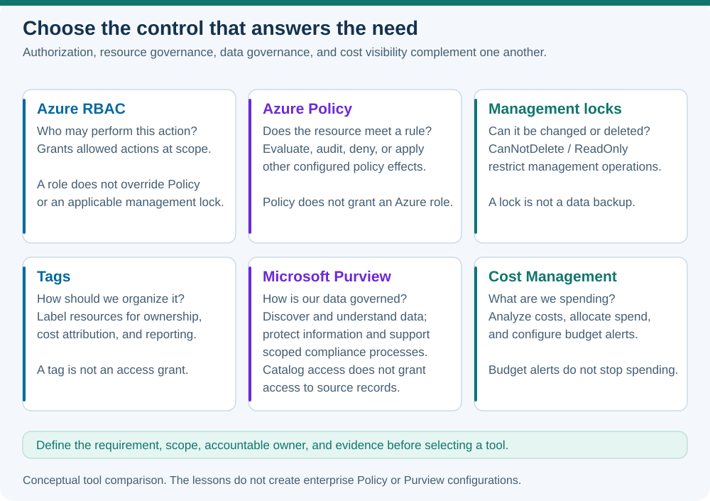

# Lab 16 — Purview, governance, and compliance

**35 minutes · Local synthetic data exercise · Offline-validated**

## Objectives

- **M05:** Explain Microsoft Purview's data governance, security, and compliance capabilities and their boundaries.

## Prerequisites

Complete [Lab 13](../13-security-models/README.md) and [Lab 15](../15-policy-locks/README.md). Use PowerShell 7.4+ for the local exercise. No Purview account, scan, license upgrade, policy, or data connector is required. Use invented asset descriptions; do not scan or publish organizational data.

## Scenario

A company has a sales report with an unclear source, a confidential customer file, and email that may be relevant to a legal case. Staff call every problem “compliance.” Classify the needs accurately and identify the capability, responsible person, and evidence each decision requires.

## Concept primer

[](../../docs/assets/diagrams/governance-controls.svg)

*A conceptual comparison of complementary tools; catalog access does not imply access to the source data.*

Microsoft Purview spans **data governance**, **data security**, and **data compliance**. Data Map captures asset metadata; Unified Catalog helps people discover and understand governed data. Metadata can include a schema, classification, owner, business definition, and lineage. A catalog describes data rather than acting as a universal source-data backup. Catalog visibility does not automatically grant access to the underlying records.

Classification describes data characteristics or sensitivity. Sensitivity labels can identify information and apply configured protections; a classification alone is not proof that every protection has been enforced. Data loss prevention helps govern sensitive-information sharing under configured policies. Ownership and a clear business purpose guide responsible use throughout the information lifecycle.

Compliance capabilities include assessments and improvement tracking, audit, retention/lifecycle management, and eDiscovery. Compliance Manager supports work against selected requirements; a score is not universal legal certification. eDiscovery addresses electronic information relevant to cases. Retention concerns how information is preserved or removed according to applicable rules. Requirements, permissions, feature availability, and licensing need review before real onboarding.

These tools complement resource governance. Azure Policy may enforce approved deployment regions; Azure RBAC grants resource actions. Purview cataloging answers questions about the data estate, while information-protection capabilities address sensitive content. A tag, catalog entry, and role assignment have different effects.

## Guided exercise

1. Create a small local catalog from invented information:

   ```powershell
   $catalog = @(
     [pscustomobject]@{Asset='SalesSummary'; Owner='Finance'; Classification='Internal'; Need='Trace report source'}
     [pscustomobject]@{Asset='CustomerContacts'; Owner='Sales'; Classification='Personal'; Need='Control external sharing'}
     [pscustomobject]@{Asset='CaseCorrespondence'; Owner='Legal'; Classification='Confidential'; Need='Preserve relevant evidence'}
   )
   $catalog | Format-Table -Wrap
   ```

   This table is synthetic local metadata, not an Azure or Purview deployment. Add a written purpose for each asset. Explain why the owner field creates accountability but does not assign the Azure Owner role.

2. Match each need to a capability. Use catalog/lineage to understand the report's source; consider information protection and DLP for sensitive sharing; consider eDiscovery and applicable retention for the case. Record one fact you would verify before configuring each real capability.

3. Add a glossary definition of “active customer.” Explain how inconsistent definitions could change two reports even if the underlying platform is available. State which data steward or business owner should approve the meaning.

4. Break-fix reasoning: a colleague says any catalog reader may download all source records. Correct the statement by separating metadata permissions from underlying data permissions. Another says “classification=personal” proves the file is encrypted; list the configured protection and enforcement evidence that would be needed.

5. Produce a local evidence checklist for a fictional assessment: requirement, scope, owner, control, evidence, and outstanding improvement action. Explain why a bare score or screenshot is insufficient to determine coverage.

## Expected results

You have three synthetic asset descriptions, named owners and purposes, appropriate capability selections, and a common business definition. You can distinguish discovery, protection, and compliance work, plus metadata versus actual data access. No source dataset is copied or scanned.

## Knowledge check

Complete the [30 original questions](questions.json). Aim for 24/30. For missed questions, identify the underlying need before selecting a Purview area; avoid assuming all governance tools do the same job.

## Troubleshooting

- **Purview portal access unavailable:** the local exercise remains complete without tenant access or paid onboarding.
- **Uncertain legal retention rule:** record the unresolved requirement and accountable reviewer in the synthetic plan. Do not invent a universal retention period.
- **“Catalog equals backup”:** a metadata inventory cannot restore all business records. Recovery requires appropriate backup design.
- **“Score equals certification”:** assessments require defined scope, evidence, ongoing actions, and relevant organizational review.

## Cleanup

No Azure or Microsoft 365 changes occur. Clear the synthetic data with `Remove-Variable catalog -ErrorAction SilentlyContinue`. Keep only invented governance notes. Existing enterprise scans, labels, retention rules, and cases are outside this lesson's scope.

## References

- [Microsoft Purview overview](https://learn.microsoft.com/en-us/purview/purview)
- [Purview data governance](https://learn.microsoft.com/en-us/purview/data-governance-overview)
- [Purview Data Map](https://learn.microsoft.com/en-us/purview/data-map)
- [Sensitivity labels](https://learn.microsoft.com/en-us/purview/sensitivity-labels)
- [Compliance Manager](https://learn.microsoft.com/en-us/purview/compliance-manager)
