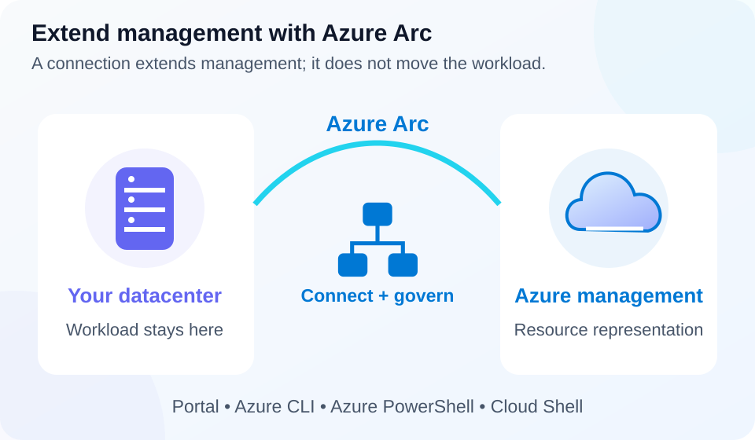

# Lab 17 — Management tools and Azure Arc

**40 minutes · Read-only tooling comparison · Offline-validated**

## Objectives

- **M08:** Explain the Azure portal's graphical management role.
- **M09:** Distinguish Cloud Shell, Azure CLI, Azure PowerShell, and the host shell.
- **M10:** Explain how Azure Arc extends management to supported external infrastructure.

## Prerequisites

Complete [Lab 00](../00-safe-start/README.md). Use PowerShell 7.4+, Azure CLI, and an enabled subscription you may inspect. The Azure PowerShell Az module and a Cloud Shell session are optional comparison points, not required installations. Do not onboard your workstation or production servers to Arc.

## Scenario

A team wants to inspect Azure resources, automate repeatable work, and organize servers that will remain in its own datacenter. Compare interfaces and select a management approach without assuming that a command tool bypasses Azure authorization or that connecting a server to Arc migrates it.

## Concept primer

[](../../docs/assets/diagrams/hybrid-management.svg)

*Arc extends supported management; the workload stays where it is, and no server is onboarded here.* [Open full-size visual](../../docs/assets/diagrams/hybrid-management.svg).

The Azure portal provides browser-based visual management, search, resource properties, and dashboards. It can be useful for initial exploration, while saved commands and templates record repeatable actions. Portal visibility depends on the selected directory, subscription, filters, and permissions. A dashboard is a view, not a deployment definition or access grant.

Azure CLI uses the `az` executable and commonly returns JSON. Azure PowerShell uses Az-module cmdlets such as `Get-AzResourceGroup` and returns PowerShell objects. PowerShell itself is a shell and language: it can host Azure CLI commands without using the Az module. Cloud Shell is a hosted shell experience with Azure tools and a choice of shell. Closing a shell does not delete deployed Azure resources. Persistent storage and deployed or connected services can have costs; review the selected environment.

Azure Arc brings supported servers, Kubernetes clusters, and other infrastructure outside Azure into Azure management. A connected external server gains an Azure resource representation so tools, scopes, tags, and supported governance services can work with it. Connection does not physically move the workload, replace its operating system, or transfer every maintenance duty. Server onboarding normally involves the Connected Machine agent, appropriate permissions, and connectivity. Optional connected services and extensions can introduce charges and operational changes.

## Guided exercise

1. Identify available local commands and inspect one explicit subscription:

   ```powershell
   $SubscriptionId = Read-Host 'Lab subscription GUID'
   Get-Command az,Get-AzResourceGroup -ErrorAction SilentlyContinue | Select-Object Name,CommandType
   az version --output json
   az account show --subscription $SubscriptionId --query '{id:id,tenant:tenantId,state:state}' --output json
   if ($LASTEXITCODE -ne 0) { throw 'Account inspection failed' }
   ```

   If `Get-AzResourceGroup` is absent, note that the Az module is not installed or loaded; do not confuse that with the `az` executable being unavailable.

2. Read the resource-group list and parse its JSON locally:

   ```powershell
   $raw = az group list --subscription $SubscriptionId --output json
   if ($LASTEXITCODE -ne 0) { throw 'Resource-group inspection failed' }
   $groups = $raw | ConvertFrom-Json
   $groups | Select-Object name,location | Format-Table
   ```

   Keep real inventory private. Explain the two layers: Azure CLI obtains JSON, and PowerShell converts it into objects. An empty result can be valid in an empty subscription.

3. Compare syntax on paper: CLI `az group list` versus Azure PowerShell `Get-AzResourceGroup`. Identify which tool handles authentication/context and how each output is used. This exercise does not require running the optional cmdlet.

4. Describe where you would inspect the same subscription and group properties in the portal. Before comparing results, align directory, subscription, filters, and permissions. A graphical view and a CLI listing can address the same underlying resources.

5. Inspect Arc's server resource-provider metadata without registering or installing anything:

   ```powershell
   az provider show --namespace Microsoft.HybridCompute --subscription $SubscriptionId --query '{namespace:namespace,registration:registrationState,types:resourceTypes[].resourceType}' --output json
   if ($LASTEXITCODE -ne 0) { throw 'Provider inspection failed' }
   ```

   A provider's registration state does not prove that any server is connected. Record a synthetic decision: an on-premises server must remain in place → evaluate Arc management; a server must move into Azure → evaluate migration separately.

## Expected results

You can distinguish the host shell from the tool invoked inside it, parse JSON for inspection, and explain why CLI, PowerShell, and portal still require authorization. You can describe Arc's external resource representation and identify permissions, connectivity, agent maintenance, and service costs as onboarding considerations.

## Knowledge check

Complete the [30 original questions](questions.json). Aim for 24/30. For each tool-selection question, identify whether the need is graphical exploration, command automation, hosted shell access, or hybrid infrastructure management.

## Troubleshooting

- **CLI command not found:** complete the tooling steps in Lab 00. Installing an Az module alone does not install Azure CLI.
- **Empty listing:** check scope and access before concluding that resources were deleted.
- **Cloud Shell session ended:** deployed resources still require explicit lifecycle cleanup; session lifetime is not resource lifetime.
- **Arc provider query denied:** use the official conceptual references; do not register providers or connect machines merely to finish the lesson.

## Cleanup

No resources, agents, extensions, or role assignments are created. Clear local inventory variables with `Remove-Variable groups,raw,SubscriptionId -ErrorAction SilentlyContinue`. Do not publish real subscription inventory. Existing Arc connections remain outside this read-only exercise.

## References

- [Azure portal overview](https://learn.microsoft.com/en-us/azure/azure-portal/azure-portal-overview)
- [Azure CLI overview](https://learn.microsoft.com/en-us/cli/azure/what-is-azure-cli)
- [Azure PowerShell overview](https://learn.microsoft.com/en-us/powershell/azure/what-is-azure-powershell)
- [Cloud Shell overview](https://learn.microsoft.com/en-us/azure/cloud-shell/overview)
- [Azure Arc overview](https://learn.microsoft.com/en-us/azure/azure-arc/overview)
- [Azure Arc-enabled servers](https://learn.microsoft.com/en-us/azure/azure-arc/servers/overview)
