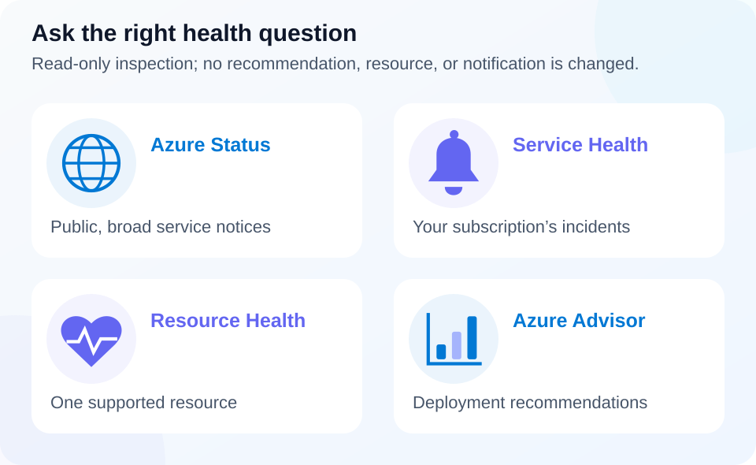

# Lab 19 — Advisor and Service Health

40 minutes · Read-only Azure inspection and local incident exercise · Offline-validated

## Objectives

- **M13:** Explain how Azure Advisor recommendations help improve existing deployments.
- **M14:** Select Azure Status, Service Health, and Resource Health for different health questions.

## Prerequisites

Complete Lab 00 and Lab 18's concepts. Use PowerShell 7.4 or newer, authenticated Azure CLI, and approved read access to the explicitly selected subscription. No resources, alerts, support cases, or recommendation-state changes are created. An empty training subscription may have no Advisor recommendations or recent health events; the synthetic exercise covers that case.

## Scenario

A community transport service sees slow requests during an Azure incident. Its manager also wants to reduce infrastructure cost next month. Separate the immediate health investigation from longer-term improvement recommendations, and identify which information supports each decision.

## Concept primer

[](../../docs/assets/diagrams/health-triage.svg)

*Recommendations and platform-health observations complement application investigation.* [Open full-size visual](../../docs/assets/diagrams/health-triage.svg).

Azure Advisor evaluates supported resource configurations and usage to suggest improvements. Its five categories are reliability, security, performance, cost, and operational excellence. A recommendation proposes an action; a person still evaluates business constraints, dependencies, testing, and permission before changing a production workload. A cost-saving suggestion is not proof that a smaller instance will meet the service's peak demand. The CLI can expose the reliability category under its older `HighAvailability` label; use the unfiltered list below rather than assuming every portal category is accepted by the CLI's `--category` argument.

Azure Status gives a public, broad view of Azure service health. Service Health gives authenticated users information relevant to the services and regions associated with their subscriptions, including incidents, planned maintenance, and advisories. Resource Health narrows the question to an individual supported resource's availability. These views complement application telemetry. An available VM does not prove its application works, and a quiet global status page does not prove every subscription is unaffected. Health information helps plan a response; it does not automatically restore your application or implement a disaster-recovery design.

## Guided exercise

1. Inspect existing information using the selected subscription. Every Azure operation here is read-only:

```powershell
$SubscriptionId = 'YOUR-SUBSCRIPTION-GUID'
az account show --subscription $SubscriptionId --query '{id:id,name:name,state:state}' -o json
if ($LASTEXITCODE -ne 0) { throw 'Subscription inspection failed.' }
az advisor recommendation list --subscription $SubscriptionId --query '[].{category:category,impact:impact,problem:shortDescription.problem}' -o json
if ($LASTEXITCODE -ne 0) { throw 'Advisor inspection failed; check approved read permissions.' }
az monitor activity-log list --subscription $SubscriptionId --offset 7d --max-events 100 --query "[?category.value=='ServiceHealth'].{time:eventTimestamp,status:status.value,operation:operationName.value}" -o json
if ($LASTEXITCODE -ne 0) { throw 'Activity log inspection failed.' }
```

The activity command filters a bounded sample of at most 100 events after retrieving it. It is a learning example, not a complete incident history. An empty result is acceptable: widen an approved read-only time range or inspect Service Health in the Azure portal without manufacturing an incident. Do not use `--refresh`, dismiss a recommendation, or select its implementation action for this lab.

2. For one returned recommendation, record its category, proposed benefit, a workload constraint to verify, and how you would test the change. If no recommendation exists, use this **synthetic example**: an underused compute instance could potentially be resized, but the next scheduled peak must be evaluated first. No real VM is resized.

3. Classify the following synthetic observations locally:

```powershell
$triage = @'
Observation,PrimaryView
Public notice of widespread regional service disruption,Azure Status
Maintenance affecting services used by our subscription,Service Health
Availability state of one supported VM,Resource Health
Recommendation to improve an existing deployment,Azure Advisor
'@ | ConvertFrom-Csv
$triage | Format-Table -Wrap
```

4. Explain why the second row is subscription-specific and the third is resource-specific. Compare those scopes with your bounded CLI observations; state what additional evidence you would request for a real incident. The portal also presents these health experiences, but this exercise requires no browser walkthrough. Do not create alerts or contact anyone during this exercise.

5. Break-fix on paper: a responder sees the VM marked available and closes an application outage. Correct the decision by checking application requests, dependencies, and errors as well as platform health. Design a hypothetical Service Health notification with subscription, service/region filter, recipient responsibility, and response procedure; creating it is outside this read-only lab.

## Expected results

You have observed existing Advisor recommendations or documented an acceptable empty result. You can choose the right health view, classify four synthetic examples, and describe an incident response that considers both Azure platform health and application behavior. You can also explain why optimizing cost and responding to an outage require different evidence.

## Knowledge check

Complete [the 30 original questions](questions.json). Explain M13 and M14 in your own words. For a wrong answer, name the question that the selected service actually answers and compare it with the scenario's scope.

## Troubleshooting

`AuthorizationFailed` requires approved read access, not a change to recommendation state. No recommendations can mean limited supported workload data or current findings; it does not certify an entire architecture. No Service Health records in a bounded Activity log sample are not proof of uninterrupted service. Keep UTC timestamps, the selected subscription context, and the query window in local notes so observations can be compared correctly.

## Cleanup

No Azure resources or state were changed. Run `Remove-Variable triage` when finished. Keep personal subscription details and observations only in ignored local evidence; remove them when no longer needed. There is no Azure lifecycle cleanup script for this read-only lab.

## References

- [Azure Advisor overview](https://learn.microsoft.com/en-us/azure/advisor/advisor-overview)
- [Advisor CLI recommendations](https://learn.microsoft.com/en-us/cli/azure/advisor/recommendation?view=azure-cli-latest)
- [Azure Service Health overview](https://learn.microsoft.com/en-us/azure/service-health/overview)
- [Activity log CLI](https://learn.microsoft.com/en-us/cli/azure/monitor/activity-log?view=azure-cli-latest)
- [Azure Monitor overview](https://learn.microsoft.com/en-us/azure/azure-monitor/fundamentals/overview)
