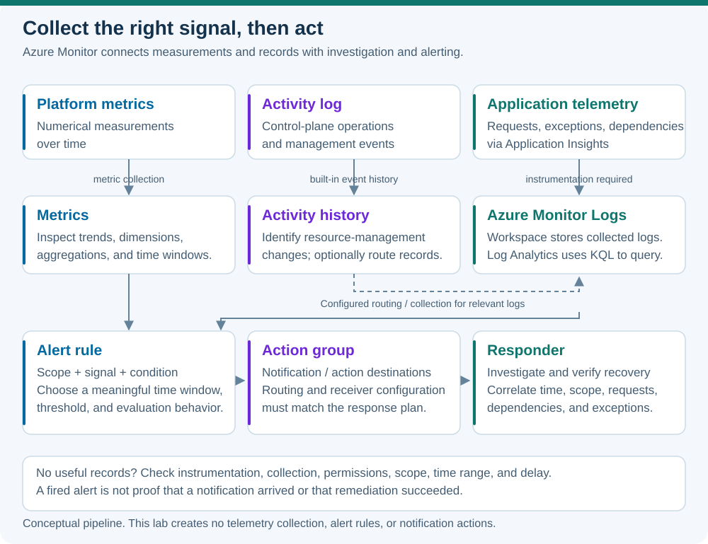

# Lab 20 — Monitor, logs, alerts, and Application Insights

45 minutes · Read-only Azure inspection and synthetic telemetry analysis · Offline-validated

## Objectives

- **M15:** Explain Azure Monitor, Log Analytics, alert rules, action groups, and Application Insights.

## Prerequisites

Complete Lab 19. Use PowerShell 7.4 or newer, authenticated Azure CLI, and approved Activity log read permission for your explicit subscription. You will not deploy a Log Analytics workspace, enable diagnostic collection, instrument an application, create an alert, or send a notification. Those production activities can incur charges and require separate design and authorization. The examples below use existing Activity log data and synthetic local records.

## Scenario

A volunteer booking site occasionally returns errors. The platform team asks who changed Azure resources; the application team asks which request and dependency were slow. Choose the appropriate telemetry and describe an alert that would help an operator respond without mistaking sample data for a production observation.

## Concept primer

[](../../docs/assets/diagrams/monitoring-signals.svg)

*Conceptual monitoring pipeline. This lesson uses read-only inspection and synthetic data; no collection, alert, or notification is configured.*

Azure Monitor collects and analyzes telemetry such as metrics, logs, traces, and events. Metrics are numerical measurements over time, often with dimensions that help separate instances or operations. Logs are records that can contain richer event context. An average can hide a few very slow requests, so aggregations and time windows must match the operational question.

The Azure Activity log describes control-plane events, such as resource-management operations. It is not a record of every blob read, SQL query, or web request. Resource logs and application telemetry require the appropriate collection configuration. Log Analytics is the Azure portal experience for querying Azure Monitor Logs with Kusto Query Language (KQL); a workspace provides a data and access boundary for log storage and analysis. A KQL query filters and aggregates collected records. Reading a query in this lab does not ingest data or execute it against a workspace.

An alert rule specifies scope, signal, and a condition. An action group defines notification or action destinations that a rule can use. A condition firing is not proof that an email arrived or that remediation succeeded: routing, receiver configuration, and response need testing. Application Insights is Azure Monitor's application performance monitoring feature. With suitable instrumentation it helps examine requests, exceptions, dependency calls, and correlated transactions. It complements platform metrics and health information. Azure does not automatically capture every line of arbitrary application behavior simply because the app runs in Azure.

## Guided exercise

1. Read recent management events. This bounded query is safe even if you have no current lab resources:

```powershell
$SubscriptionId = 'YOUR-SUBSCRIPTION-GUID'
az monitor activity-log list-categories --subscription $SubscriptionId -o json
if ($LASTEXITCODE -ne 0) { throw 'Activity category inspection failed.' }
az monitor activity-log list --subscription $SubscriptionId --offset 7d --max-events 50 --query '[].{time:eventTimestamp,operation:operationName.value,status:status.value,category:category.value}' -o json
if ($LASTEXITCODE -ne 0) { throw 'Activity log query failed; inspect approved read access.' }
```

Choose a returned operation and explain its management meaning. An empty subscription/window is acceptable; use the synthetic records below. Do not create a failed deployment just to generate a log entry. Keep the selected UTC time window and result limit with your notes.

2. Analyze **synthetic application telemetry locally in PowerShell**. This is not data from Application Insights:

```powershell
$requests = @'
Name,DurationMs,Success
GET /bookings,120,true
POST /booking,900,false
GET /bookings,100,true
POST /booking,1100,false
'@ | ConvertFrom-Csv
$requests | Format-Table
$failures = @($requests | Where-Object Success -eq 'false').Count
$meanDuration = ($requests | ForEach-Object { [double]$_.DurationMs } | Measure-Object -Average).Average
[pscustomobject]@{Requests=$requests.Count; Failures=$failures; MeanDurationMs=$meanDuration}
```

Expect four requests, two failures, and mean duration `555` ms. The two failed POST requests are also slower here, but that correlation alone does not establish their cause. Identify the dependency, exception, and transaction context you would seek from properly instrumented application telemetry.

3. Read this **synthetic KQL example**, which runs nowhere automatically:

```kusto
datatable(Name:string, DurationMs:real, Success:bool)
[
  'GET /bookings', 120.0, true,
  'POST /booking', 900.0, false,
  'GET /bookings', 100.0, true,
  'POST /booking', 1100.0, false
]
| where Success == false
| summarize Failures=count(), MeanDurationMs=avg(DurationMs) by Name
```

Expected logical result: `POST /booking`, two failures, average duration `1000` ms. `where` selects failed records and `summarize` groups and aggregates them. This `datatable` uses invented column names; real workspace and Application Insights table names depend on the data schema and query context. Do not paste the example into PowerShell as a command.

4. Draft an alert design locally: monitor booking request failure rate over a justified five-minute window, require enough requests to make the percentage useful, and route a notification through an action group to the responsible operator. Specify what evidence that operator investigates next. No rule or receiver is created or contacted.

5. Break-fix on paper: a designer alerts on an entire day's mean latency and misses a short outage. Choose a useful evaluation window and aggregation, validate against known incidents and quiet periods, and document how to reduce noise without hiding failures. For a blank application dashboard, check instrumentation, collection, query scope, time range, and ingestion delay before concluding there was no traffic.

## Expected results

You can distinguish control-plane history from workload telemetry, explain metrics versus logs, predict a small KQL query, and design an alert with a response owner. Your synthetic results match the expected counts and averages, and your incident investigation includes requests, dependencies, and exceptions without claiming that telemetry was collected from Azure.

## Knowledge check

Complete [the 30 original questions](questions.json). Describe the difference between an alert condition and an action group. Explain why a workspace with no relevant records and an application with no instrumentation cannot answer every monitoring question.

## Troubleshooting

Check CLI exit codes before interpreting empty output. For Activity log results, verify subscription, permissions, time range, filters, and the event cap. CSV fields are strings; convert numeric duration values before arithmetic. A local arithmetic result confirms the sample calculation only. It does not validate a real KQL runtime, production collection pipeline, alert notification, or application performance.

## Cleanup

No Azure changes were made and no notification was sent. Run `Remove-Variable requests,failures,meanDuration` when finished. Delete optional local telemetry notes containing learner identifiers when no longer needed. This read-only lab has no resource lifecycle scripts.

## References

- [Azure Monitor overview](https://learn.microsoft.com/en-us/azure/azure-monitor/fundamentals/overview)
- [Activity log CLI](https://learn.microsoft.com/en-us/cli/azure/monitor/activity-log?view=azure-cli-latest)
- [Log queries and Log Analytics](https://learn.microsoft.com/en-us/azure/azure-monitor/logs/log-query-overview)
- [Azure Monitor alerts](https://learn.microsoft.com/en-us/azure/azure-monitor/alerts/alerts-overview)
- [Application Insights overview](https://learn.microsoft.com/en-us/azure/azure-monitor/app/app-insights-overview)
